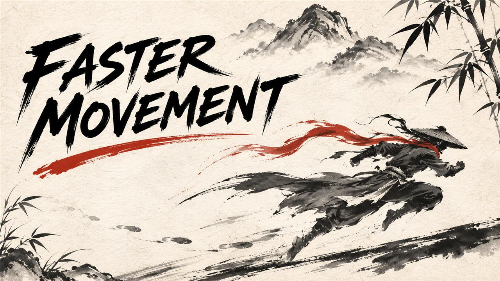

# Faster Movement

The player walks, runs and sprints faster (x2 by default), with jog, sprint and boat speeds and sprint modes. A PBZModLoader mod, live settings.

## What it does

Your character walks, runs and sprints faster: x2 as installed, anything from 0.5 to 3, set live.

- **One speed for all**, or a speed of its own for running (jog) and for sprinting.
- **Super Sprint** (the talent that starts after 2 s of sprinting) keeps pace with the sprint speed.
- **Sprint modes:** Hold (the game's own), Toggle, Auto (out of combat you sprint whenever you move) or Always.
- **Boat speed:** the boat you steer, 0.5 to 2.

Attacks and dodges keep their speed. Enemies are not changed.

It is a PBZModLoader mod: a script in the game's own script engine. It replaces no game file and writes nothing into
the save: the speed is a timed effect on top of your stock values, so with the mod removed you are back to stock.

## Screenshots

## How to install

1. Install [PBZModLoader](https://github.com/KintaroModding/phantombladezero_pbzmodloader) 2.1.0 or later.
2. Download the zip of the latest release on GitHub (`phantombladezero_fastermovement_<version>.zip`).
3. Unpack it into the game folder (the folder that holds `ProjectPBZ`). It adds the folder
   `ProjectPBZ\PBZModLoader\mods\phantombladezero_fastermovement\` with `main.js` and the settings file.
4. Start the game.

To check that it runs: `ProjectPBZ\PBZModLoader\loader.log` has the line
`[PBZMOD] [Faster Movement] <version> started; settings: ...`.

To update the mod, replace `main.js` with the one of the new release; keep your settings file (a setting that it does
not have keeps its default). To remove the mod, delete the folder `ProjectPBZ\PBZModLoader\mods\phantombladezero_fastermovement\`.

## How to use

Nothing to do: the mod works as soon as you load a game (x2).

To change the speed, use the Mods Menu page or the settings file below. With **Toggle**, **Auto** or **Always**, the
sprint key of your keyboard or controller works as described in the settings.

## Settings

The settings are in `ProjectPBZ\PBZModLoader\mods\phantombladezero_fastermovement\phantombladezero_fastermovement.txt`. Open it with a text editor,
change a value and save: the mod reads the file every 2 seconds, so the game uses it without a restart. Without the
file the mod uses the defaults below. Keys are not case-sensitive; `;` or `#` starts a comment.

**With Mods Menu** (0.9.0 or later) in the game, the mod adds its page to Mods Menu's tab in the game's settings, and
the page's settings are the ones that count: Mods Menu keeps them in its own file in the game's `Saved` folder, and
the file in the mod's folder is not read then.

| Setting | Default | What it does |
|---|---|---|
| `Speed` | `2` | How fast you walk, run and sprint, 0.5 to 3 (1 = the game's own, 2 = twice as fast) |
| `Jog` | `Same` | Running without the sprint key: `Same` (as `Speed`) or 0.5 to 3, a speed of its own |
| `Sprint` | `Same` | Sprinting, Super Sprint included: `Same` (as `Speed`) or 0.5 to 3, a speed of its own |
| `SprintMode` | `Hold` | `Hold`: the game's own. `Toggle`: press sprint while moving and you keep sprinting until you press it again or stop. `Auto`: out of combat you sprint whenever you move; press sprint to run instead until you stop. `Always`: `Auto` in combat too; there a sprint press does not turn it off, so sprint attacks work |
| `Boat` | `1` | How fast the boat you steer goes, 0.5 to 2 (1 = the game's own). Docking and scripted rides keep their speed |

## Compatibility

- Game version: Steam build 26367565 (`CL-302256_JKS-17280`).
- Needs PBZModLoader 2.1.0 or later. Mods Menu is optional.
- Phantom Tuner has its own `PlayerSpeed` (jog and sprint). Both can run together: the speeds then multiply (x2 here
  and x1.5 there give x3). Nothing loops or grows by itself. Use the one you prefer, or set the other to 1.
- Another mod that changes the player's walk, jog or sprint speed, the sprint key or the boat: test them together.

## Known issues

- None known.

## How to build

There is nothing to build: `src\phantombladezero_fastermovement\` is the mod folder (`main.js` and the settings file).
`tests\test_mod.js` runs the script outside the game with Node.js and stand-ins for the game: `node tests\test_mod.js`.
`README.md` has the details.

## Credits

Made by Kintaro. MIT license: you may use, change and share this mod. PBZModLoader is made by LKF, its fork by
KintaroModding. Phantom Blade Zero and its files belong to their makers.
